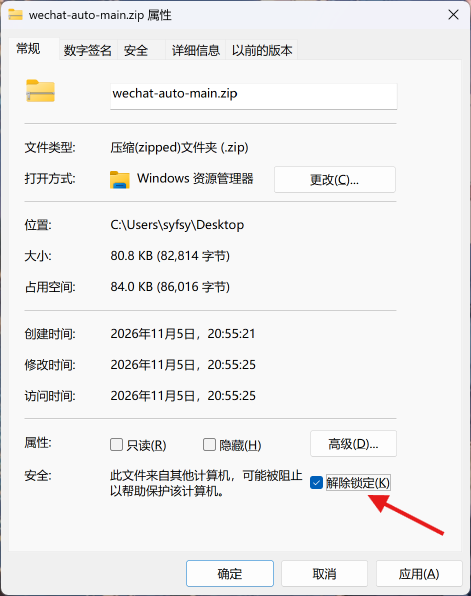

# 微信自动回复

这是一个运行在 Windows 上的微信自动回复工具。程序读取指定联系人的新消息，把聊天上下文
交给 DeepSeek 生成回复，再自动发送到微信。

它不是微信官方接口，而是通过 Windows UI Automation 操作微信界面。微信更新后，界面控件
可能变化，程序也可能因此失效。

## 先看兼容性

| 项目 | 要求 |
| --- | --- |
| 操作系统 | Windows 10 或 Windows 11 |
| Python | Python 3.10 或更高版本，推荐官方安装包 |
| 微信 | 简体中文界面，当前开发与适配基准为 **微信 4.1.15.50** |
| 网络 | 能够访问 DeepSeek API；联网搜索需要额外访问 DeepSeek Search API |
| 账号 | 已登录自己的微信账号，并准备自己的 DeepSeek API Key |

本机当前微信版本为 `4.1.15.50`。代码中的窗口类名、按钮文字和界面结构都是按这个版本
适配的，因此：

- **使用相同版本成功率最高。**
- 其他微信 4.x 版本可以尝试，但不能保证可用。
- 微信 3.9 不支持。
- 必须使用简体中文界面；界面语言变化后，程序可能找不到按钮或菜单。
- 即使版本号相同，腾讯灰度更新、不同安装包或界面结构变化也可能影响联系人搜索和聊天窗口识别。

程序没有固定的版本号检查，但界面不匹配时通常会出现“找不到微信窗口”“没有返回任何联系人”
或“没能打开独立聊天窗口”等错误。这不是 API Key 或网络问题。

查看微信版本：打开微信左下角菜单，进入“设置”→“关于微信”。

> 当前代码按“双击会话后打开独立聊天窗口”的方式设计。部分微信 4.x 界面会直接把聊天
> 显示在主窗口内，此时需要修改适配代码。给其他人使用前，建议先在自己的微信版本上完整测试。

## 安全说明：它是如何操作微信的

这个项目不是通过模拟微信网络协议收发消息，也不会向微信进程注入代码。它使用的是
Windows 提供的 **UI Automation（界面自动化）** 接口，相当于让程序读取微信窗口的
控件结构，再按照界面上的按钮、输入框和菜单执行操作。

几种常见方式可以简单对比为：

| 方式 | 通俗理解 | 是否修改微信程序或进程内存 | 是否拦截或伪造网络协议 | 本项目是否使用 |
| --- | --- | --- | --- | --- |
| UI Automation | 通过 Windows 无障碍接口找到微信输入框、按钮和消息控件 | 否 | 否 | **使用** |
| 协议模拟 | 自行实现一套类似微信客户端的网络收发方式 | 不一定 | 是 | 不使用 |
| Hook / 注入 | 把代码挂进微信进程，拦截或修改微信内部调用 | 是 | 通常涉及 | 不使用 |

本项目还会向微信窗口投递键盘、鼠标和滚轮消息，用 `PrintWindow` 在后台截取窗口画面。
它没有调用 `SendInput` 移动真实光标，不会改写微信程序文件，也不会读取或解密微信本地
聊天数据库。获取聊天内容的方式是读取微信当前界面中已经显示的控件和画面。

因此，和其他直接修改客户端、Hook 进程或模拟私有协议的做法相比，这种实现接触的系统
范围更窄，相对技术风险通常更低。不过它仍然不是微信官方支持的功能，也不是“零风险”：

- 微信更新界面后，控件结构可能变化，导致按钮找不到或识别错误。
- 个别界面会自动切换前台，程序会尝试还原，但 Windows 可能拒绝切换。
- 自动化最终仍是在执行界面点击和消息发送，使用前应确认当前聊天对象和配置。
- 使用时应遵守微信平台规则，不要用于骚扰、诈骗、批量营销或其他违规用途。

程序不会索取微信密码或扫码登录权限。与 DeepSeek 相关的数据发送范围见下方
“隐私说明”。

## 程序能做什么

- 监听一个联系人的新消息并自动回复。
- 读取最近的聊天上下文，避免只回复最后一句。
- 按需联网搜索天气、新闻、价格等实时信息。
- 分析对方新发来的图片或表情包。
- 使用微信自带功能把对方语音转成文字。
- 在聊天风格允许时，从微信“自定义表情”收藏中发送原生贴纸。

程序不会批量群发消息，也不保证支持群聊。每次启动只处理一个指定联系人。

## 第一次使用

### 方案一：使用 WorkBuddy 等电脑 Agent 辅助安装

如果不想自己检查 Python、下载文件和安装依赖，可以把下面的提示词复制给 WorkBuddy
或其他能够操作电脑的 Agent。Agent 会协助下载、安装、检查环境和介绍日常用法。

复制前请确认 Agent 只使用下面这个官方项目地址。API Key 应由你在配置窗口中亲自填写，
不要直接发到聊天窗口里。

```text
请作为耐心的 Windows 软件安装助手，帮我在这台电脑上安装并运行这个开源项目：
https://github.com/syf08/wechat-auto

我是电脑小白，请用高中以下也能听懂的中文，一步一步带我完成，不要一次堆很多术语。

请完成这些事情：
1. 先检查我是否使用 Windows 10/11，是否安装了 Python 3.10 或更高版本、Git，
   以及微信是否已经安装。缺少软件时，先用简单语言告诉我需要装什么，并优先给出
   官方下载方式，等我确认后再继续。
2. 使用 git clone 下载官方仓库的最新 main 分支，放到一个普通用户可写、
   路径中尽量没有特殊字符的项目文件夹。不要从其他陌生地址下载。
3. 在项目目录创建独立的 .venv 虚拟环境，用其中的 Python 安装 requirements.txt。
   安装命令和错误信息请保留下来，失败时解释原因后再尝试安全可行的修复。
4. 引导我打开配置窗口，让我自己填写名字、聊天风格和 DeepSeek API Key。
   绝对不要让我把 API Key 发到聊天中，也不要读取、显示、记录或上传已保存的密钥。
5. 配置完成后，先引导我使用“文件传输助手”发送几条测试消息，确认程序能够读取、
   回复和恢复前台。不要在未确认前自动发送其他内容。
6. 用小白能听懂的方式说明日常使用：什么时候打开配置、怎样启动、怎样停止、
   控制台为什么要保持打开，以及 user_config.json 和 config_secret.bin 是什么。
7. 向我介绍“原生收藏表情/贴纸”功能：说明它默认关闭、怎样在功能开关中启用、
   需要粘贴贴纸目录，并解释贴纸编号从收藏面板右下角开始、每行从右到左、
   再逐行向上。告诉我贴纸是根据聊天语境选择，不是每句话都会发送；发送贴纸时
   微信可能短暂抢占前台，完成后会尝试还原。
8. 说明联系人搜索、对方语音转文字和发送原生贴纸时，微信可能短暂闪现到前台；
   普通回复也可能偶发抢占前台。遇到偶发前台切换时，先停止并重新运行脚本试试。
9. 如果 BAT 被 Windows 智能应用控制拦截，按 README 的“解除锁定”或 git clone
   方式处理，不要关闭智能应用控制，也不要降低系统安全设置。
10. 每次只做一个关键步骤，完成后告诉我检查结果，再继续下一步。
11. 不要删除个人文件、聊天记录或配置。需要删除、覆盖或执行不可逆操作前先问我。

请优先保证安全和易懂，不要为了“自动完成”而跳过我的确认。全部完成后给我一张
简短的日常使用说明卡，包含启动、配置、停止、测试、贴纸功能和常见前台切换现象。
```

### 方案二：手动下载并运行

#### 从 GitHub 下载 ZIP 时先解除锁定

如果通过 GitHub 的 **Code → Download ZIP** 下载项目，Windows 可能把压缩包标记为
“来自其他计算机”。在开启“智能应用控制”的 Windows 11 上，直接解压并运行 `.bat` 时，
可能被提示“智能应用控制已阻止可能不安全的文件”。这不是 Python 或项目代码错误。

建议在解压前：

1. 右键下载的 ZIP，选择“属性”。
2. 在“常规”页面底部找到“安全”提示。
3. 勾选“解除锁定”，然后点击“应用”或“确定”。
4. 重新解压后再运行启动器。



如果已经解压，可以在 PowerShell 中进入项目目录，再取消文件的网络来源标记：

```powershell
Get-ChildItem -Recurse -File | Unblock-File
```

如果 `.bat` 仍然被拦截，可以改用 `git clone` 获取项目，或直接使用 Python 启动，
不要通过关闭“智能应用控制”来绕过保护。

#### 配置和启动

1. 把整个项目文件夹解压或复制到本地目录。
2. 启动微信并完成登录。
3. 双击 `配置微信自动回复.bat`。
4. 在配置窗口中填写个人名字、聊天风格和 DeepSeek API Key。
5. 点击“保存配置”。
6. 双击 `启动微信自动回复.bat`。
7. 按控制台提示输入联系人名称。

联系人名称必须与微信中的备注名或昵称完全一致。第一次运行可以先用“文件传输助手”发送几条
测试消息，确认配置和前台切换正常后即可切换为日常使用的联系人。

首次启动时，启动器会自动创建 `.venv` 并安装 `requirements.txt` 中的依赖，因此需要联网，
安装过程可能需要几分钟。之后的启动会更快。

运行过程中请保持控制台窗口打开；关闭控制台就会停止自动回复。

## 配置窗口

双击 `配置微信自动回复.bat` 会打开三个页面。

### 个人信息与聊天风格

这里设置个人名字、回复长度、补充偏好，以及幽默感、热情度、直接程度和温柔度。

这些设置不会改写 `prompt.txt`，而是作为补充人设说明追加到本次运行的提示词中。

### 功能开关

| 功能 | 默认状态 | 说明 |
| --- | --- | --- |
| 按需联网搜索 | 开启 | 只有需要实时信息时才搜索 |
| 图片与表情包分析 | 开启 | 分析对方新发的图片，默认保留最近 8 张作为后续上下文 |
| 启动历史记录 | 20 条 | 可设置启动时读取最近 `0～50` 条，`0` 表示不读取 |
| 原生收藏贴纸 | 关闭 | 开启后必须粘贴自己的贴纸目录 |

历史记录数量越多，模型可参考的聊天上下文越完整，但启动读取和 API 请求也会更慢、更大。

关闭图片分析后，图片和表情包只显示为 `[图片]`、`[表情包]` 等文字占位符。

图片分析开启时，可以设置“后续回复保留最近几张历史图片”，范围为 `0～20`：

- `0`：不保留历史图片，但当前新图片仍会正常分析。
- `8`：默认值，在后续回复中最多附带最近 8 张图片或表情包。
- 数量越大，后续模型请求携带的图片越多，API 请求大小和费用也可能增加。

原生收藏贴纸还会执行最近使用去重和发送间隔控制：

- “最近去重”可设置 `0～30` 张，默认 `6` 张，表示最近成功发送的 6 张贴纸不再参与选择；
  设为 `0` 可关闭去重。
- “文字回复间隔”可设置 `0～20` 条，默认 `0`，表示每条符合语境的回复都可以考虑贴纸；设为 `N` 后，
  每成功发送一张贴纸，至少要再发送 N 条纯文字回复，才会考虑下一张。
- 如果去重范围暂时排除了目录中的全部贴纸，本轮只发送文字，不会强行重复使用旧贴纸。

“表情包回复严格程度”控制选择器返回 `none` 后的行为：

- “严格”（默认）：保持原逻辑，选择器认为语境不合适时只发送文字。
- “宽松”：选择器返回 `none` 时，程序会再用更宽松的标准，从当前未被近期去重排除的
  贴纸中重新选择一张相对最接近当前语境的贴纸。
- 第二次允许“基本合适”或较弱关联，只要不会明显改变语气就会尽量选择。
- 如果第二次仍然没有合适候选、返回无效 ID 或调用失败，本轮就不发贴纸，只发送文字。
- 该设置只影响 `none` 后的补选，不改变第一次严格选择的具体语义判断。

### API Key

API Key 使用 Windows DPAPI 加密保存在 `config_secret.bin`，不会写入 `user_config.json`。

- `config_secret.bin` 只能由保存它的 Windows 用户解密。
- 不要把 `config_secret.bin` 发给其他人。
- 更换电脑或 Windows 用户后，需要重新保存 API Key。
- 如果设置了 `DEEPSEEK_API_KEY` 环境变量，环境变量优先。

API 调用会产生费用，由 API Key 所属的 DeepSeek 账户承担。

## 启动后会发生什么

程序启动后会：

1. 在微信中搜索联系人。
2. 尝试打开该联系人的聊天窗口。
3. 按配置读取最近 `0～50` 条聊天记录作为启动上下文，默认 20 条。
4. 确认聊天视图位于最底部。
5. 开始监听新消息。

程序无法确认聊天视图在最底部时会主动退出，避免把旧消息当成新消息重复回复。

运行期间：

- 只回复对方的新消息，不回复自己发送的消息。
- 无法判断发送方时选择不回复，避免自己和自己聊天。
- 回复生成期间收到的新消息会排队处理。
- 聊天窗口被最小化时会尝试恢复，但通常不会抢占前台。
- 文字回复通过后台窗口消息发送。
- 原生贴纸需要短暂打开微信表情面板，完成后会还原原来的前台窗口。

## 前台窗口与操作提示

- 在微信搜索框输入联系人并匹配时，部分微信版本可能短暂把微信搜索弹层或主窗口切到前台。
  程序开始配对前会记录原前台窗口，并在配对成功或失败后尝试交还前台。
- 发送原生收藏贴纸时，微信表情面板可能短暂占用前台。程序点击贴纸后会尝试把前台交还给
  操作前的窗口。
- 对方发来语音时，程序需要调用微信自身的“语音转文字”，微信界面可能短暂一闪而过地切到
  前台。这个过程通常很快就会结束。
- 少数情况下，普通回复也可能在没有搜索或发送贴纸时偶尔占用前台。目前没有稳定的复现条件，
  表现带有一定随机性。可以先停止脚本并重新运行试试，部分情况下会恢复正常。
- 文字消息收发、读取聊天记录和滚动聊天视图使用后台窗口消息，不会主动激活微信。
- Windows 可能拒绝程序还原前台，例如原窗口已经关闭，或前台权限被其他程序占用。程序会尽量
  恢复，但无法保证所有系统状态下都能无缝切换。启动配对和发送贴纸期间，尽量不要手动切换
  前台窗口或操作微信。

## 同时监控两个联系人

程序每次启动只监控一个联系人，但可以同时打开两个独立的命令窗口，让两个进程分别监控
两个联系人。

当前配置采用“启动时读取一次”的方式：

1. 使用配置 A 启动第一个 `启动微信自动回复.bat`，输入联系人 A。
2. 等待第一个窗口完成连接并显示开始监听。
3. 打开配置窗口，修改为联系人 B 需要的配置并保存。
4. 再启动第二个 `启动微信自动回复.bat`，输入联系人 B。
5. 保持两个命令窗口都开启。

这样操作时：

- 第一个进程继续使用启动时读入内存的配置 A。
- 第二个进程使用后来保存的配置 B。
- 修改名字、聊天风格、功能开关、图片保留数量、贴纸目录或 API Key，不会改变已经启动的
  第一个进程。
- 两个进程的聊天上下文、图片记忆和回复状态彼此独立。

需要注意：

- 必须等第一个进程完全启动后再修改配置，否则它可能读到修改后的新配置。
- 磁盘上的 `user_config.json` 和 `config_secret.bin` 只有一份，最终保存的是最后一次修改；
  下次重启第一个联系人时，需要再次切换配置。
- 两个进程共用同一个微信客户端，建议依次启动，避免同时操作联系人搜索框。
- 不建议两个进程同时发送原生贴纸，因为它们共用微信表情面板，可能互相干扰。
- 两个进程会分别调用 DeepSeek，模型请求数量和费用也会相应增加。

如果只是临时同时监控两个人，上述方法可以使用。如果准备长期运行，建议复制成两个独立
项目文件夹，让每个文件夹分别保存自己的 `user_config.json` 和 `config_secret.bin`。

## 提示词与 Emoji

主要规则位于 `prompt.txt`。修改后需要重新启动程序才会生效。

程序没有提供临时修改提示词的功能。配置窗口中的姓名和聊天风格只会追加个性化说明，
不会覆盖 `prompt.txt` 中的真实性、安全性和发送格式规则。

Emoji 无法通过当前后台输入方式可靠地与文字一起发送，因此程序不支持 Emoji。模型偶然
生成的表情符号或颜文字会在发送前被移除。

## 原生收藏贴纸

原生贴纸目录与每个微信账号的收藏内容有关，所以发行版不附带作者的贴纸目录。

使用方法：

1. 在“功能开关”页打开“原生收藏贴纸”。
2. 点击“粘贴 / 编辑贴纸目录...”。
3. 按下面的三栏格式粘贴目录。
4. 点击“保存贴纸目录”，再点击主窗口的“保存配置”。
5. 重新启动主程序。

每行填写一张贴纸，严格使用半角竖线 `|` 分成三栏：

```text
贴纸ID | 适用语义 | 收藏序号
```

例如：

```text
# 从收藏面板右下角开始，每行从右到左，再逐行向上
rofl_emoji | 爆笑、狂笑 | 0
sad_frog | 苦涩、难过 | 3
```

规则：

- 贴纸 ID 只能使用小写英文字母、数字、下划线和短横线，且不能重复。
- 同一个收藏序号只能出现一次；贴纸 ID 和收藏序号都会在保存时去重校验。
- 适用语义写给 AI 看，应说明适合使用的情绪或动作。
- 收藏序号从 `0` 开始，从“自定义表情”面板最右下的贴纸开始编号。
- 每一行从右到左编号，当前行结束后再移到上一行，并从右侧继续向左。
- 微信新增收藏会插到最前面，原有贴纸向后移动；从右下角反向编号与此方向一致，
  可以减少顶部新增贴纸造成的已有序号偏移。
- 每行必须正好三栏，不能添加其他字段。
- 以 `#` 开头的行是注释，空白行会被忽略。

例如每行有 5 个贴纸时，面板中的序号排列为：

```text
较上一行： 9  8  7  6  5
最底下一行：4  3  2  1  0
```

> **兼容性提醒：**旧版本按“从左到右”填写并保存的贴纸目录，升级后必须按“从右到左”
> 重新编号。否则贴纸 ID 仍能正常保存，但程序可能点击到同一行中的其他贴纸。

程序会先滚动到收藏面板最底部，再按上述顺序定位贴纸，并且只点击完全位于收藏网格内的格子，
避免点中下方工具栏。如果之后删除或移动贴纸，仍需要同步检查目录中的序号。

## 联网、图片和语音

### 联网搜索

模型会自行判断是否需要搜索。每次回复最多搜索一次，只把模型生成的短搜索词发送给
DeepSeek Search API，不会把完整聊天记录作为搜索词发送。

搜索失败时，程序会让模型自然带过，不会把接口错误直接发到微信。

### 图片与表情包

对方新发图片或表情包时，程序会截取当前这条消息并交给视觉模型理解。历史记录中的图片、
视频、文件、链接仍使用文字占位符。

“功能开关”页可以设置后续回复保留几张历史图片，范围为 `0～20`，默认 `8`。程序会去重，
只保留最近收到的图片，退出程序后这些图片全部从内存中消失。

### 语音

对方发来新语音时，程序会调用微信自身的“语音转文字”，再把转写内容作为聊天上下文。

## 隐私说明

为了让 DeepSeek 生成回复，程序会把以下内容发送给 DeepSeek API：

- 启动时读取的最近聊天记录。
- 本次运行期间保留的聊天上下文。
- 对方的新消息。
- 开启图片分析时，对方新图片或表情包的截图。
- 开启语音转文字时，微信生成的语音转写内容。
- 联网时，模型生成的短搜索词。

### 聊天数据不落盘

以下运行数据只保存在当前进程的内存中，不会由本程序写成聊天日志、截图文件或缓存：

- 启动历史和运行期间的聊天上下文。
- 对方图片和表情包的截图及其图片上下文。
- 语音转写内容。
- 搜索结果。
- 当前生成的回复和近期贴纸记录。

程序退出、进程崩溃或电脑重启后，这些内存数据会消失，程序不会在下次启动时恢复它们。

### 仍会写入磁盘的文件

“聊天内容不落盘”不等于程序完全不写文件。运行过程中仍可能产生：

| 文件或目录 | 内容 | 是否包含聊天记录 |
| --- | --- | --- |
| `user_config.json` | 个人名字、聊天风格、功能开关、图片保留数量和贴纸目录 | 否 |
| `config_secret.bin` | 使用 Windows DPAPI 加密后的 API Key | 否 |
| `.venv` | 首次运行时安装的 Python 依赖 | 否 |
| `__pycache__` | Windows 官方 Python 自动生成的字节码缓存 | 否 |

保存配置时可能短暂生成 `user_config.json.tmp` 或 `config_secret.bin.tmp`，保存完成后会被
替换或清理。程序自身不创建聊天日志、聊天截图文件或聊天缓存。

聊天上下文、图片截图和语音转写仍会发送给 DeepSeek API。DeepSeek 如何处理提交的数据，
应参考其服务条款和隐私政策；这不属于本程序本地内存或本地磁盘的存储范围。

不要在包含密码、验证码、身份证件、财务信息或其他高度敏感内容的聊天中使用。

## 常见问题

### 微信里明明搜索到了联系人，程序却说找不到

这通常是微信界面与代码不兼容造成的。程序依赖微信未公开的 UI Automation 控件结构，
不是通过官方联系人接口搜索。

请先确认：

- 微信是否为简体中文界面。
- 是否接近 `4.1.15.50` 的界面版本。
- 联系人名称是否与备注名或昵称完全一致。
- 搜索弹层是否显示在主窗口内，而不是单独窗口。

如果微信界面能看到结果，但程序提示“搜索没有返回任何联系人”，需要更新
`wechat_session.py` 中的搜索候选识别逻辑。

### 提示没能打开独立聊天窗口

部分微信版本会把聊天显示在主窗口内，而当前程序仍按独立聊天窗口查找。遇到此问题需要
修改 `wechat_session.py` 和 `wechat_ui.py` 的窗口识别逻辑。

### 提示找不到微信窗口

先确认微信已经启动并登录。微信最小化到托盘时通常可以恢复，但某些版本需要先把主窗口
显示出来。

### 连不上 DeepSeek

检查网络、API Key 和账户余额。更换电脑或 Windows 用户后，需要重新打开配置窗口保存 Key。

### 一直安装依赖失败

手动打开 PowerShell，进入项目文件夹后执行：

```powershell
python -m pip install -r requirements.txt
```

安装完成后再次双击启动器。

### 配置窗口打不开

建议安装 Windows 官方 Python，并保留 Tcl/Tk 组件。也可以在命令行运行：

```powershell
python settings_ui.py
```

### 回复没有发送

查看控制台中的具体错误，重点检查：

- 独立聊天窗口是否仍然打开。
- 输入框是否被手动占用。
- 微信界面是否与适配版本一致。
- 控制台是否显示截图、模型或输入发送失败。

## 可选命令行用法

普通用户直接双击两个 `.bat` 文件即可，一般不需要命令行。

| 命令 | 用途 |
| --- | --- |
| `python bot.py` | 启动后交互输入联系人 |
| `python bot.py 联系人名` | 直接指定联系人 |
| `python bot.py --configure` | 打开可视化配置窗口 |
| `python bot.py --reply-pending` | 如果最后一条是对方发的，先补回一条 |
| `python bot.py --selftest` | 用最后一条记录跑完整流程，会真的发送消息 |

`--selftest` 和 `--reply-pending` 不能同时使用。`--selftest` 会向当前联系人发送真实消息，
运行前请确认当前聊天对象和待发送内容。

高级运行参数位于 `config.py`。一般使用不需要修改，建议优先使用配置窗口。

## 项目文件说明

运行所需的主要文件位于项目根目录；下面按用途说明。GitHub 版本另含 `.gitignore` 和
README 使用的说明图片。

### 启动、配置和运行基础

| 文件 | 作用 | 一般需要修改吗 |
| --- | --- | --- |
| `配置微信自动回复.bat` | 双击打开可视化配置窗口 | 不需要 |
| `启动微信自动回复.bat` | 双击启动主程序，并自动检查 Python、创建 `.venv`、安装依赖 | 不需要 |
| `bot.py` | 主程序入口，负责联系启动流程、读取消息、生成回复、重试和发送 | 通常不需要 |
| `settings_ui.py` | 编写可视化配置窗口，包括个人信息、功能开关、贴纸目录和 API Key 页面 | 通常不需要 |
| `user_settings.py` | 读取和保存 `user_config.json`，生成个性化提示词，并校验贴纸目录格式 | 通常不需要 |
| `secret_store.py` | 使用 Windows DPAPI 加密、解密和保存 API Key | 不需要 |
| `config.py` | 保存模型、联网、图片、轮询间隔和贴纸等底层运行参数 | 高级用户才需要 |
| `requirements.txt` | 列出程序依赖的 Python 第三方包 | 升级依赖时才需要 |

### 微信界面自动化

| 文件 | 作用 | 一般需要修改吗 |
| --- | --- | --- |
| `wechat_session.py` | 在微信搜索联系人、点击搜索结果并打开聊天窗口 | 微信搜索界面改版时才需要 |
| `wechat_ui.py` | 微信底层自动化：查找控件、读取消息、输入文字、发送、滚动和发送收藏贴纸 | 微信控件结构改版时才需要 |
| `wechat_capture.py` | 后台截取微信窗口，判断消息是对方还是自己发送，并裁剪图片消息 | 通常不需要 |
| `message_monitor.py` | 记录当前消息锚点，判断启动后又出现了哪些新消息 | 通常不需要 |

### AI、对话和提示词

| 文件 | 作用 | 一般需要修改吗 |
| --- | --- | --- |
| `deepseek_client.py` | 调用 DeepSeek 聊天接口，并协调按需联网搜索 | 通常不需要 |
| `deepseek_search.py` | 调用 DeepSeek Search API，整理搜索结果并处理搜索重试 | 通常不需要 |
| `conversation.py` | 只在内存中保存聊天上下文、图片记忆、已发送回复和近期贴纸记录 | 通常不需要 |
| `stickers.py` | 读取贴纸目录、生成贴纸选择提示词，并解析模型返回的贴纸 ID | 通常不需要 |
| `prompt.txt` | 主系统提示词，规定回复身份、格式、联网、图片和语气等硬性规则 | 想调整基础规则时才修改 |

### 文档

| 文件 | 作用 | 一般需要修改吗 |
| --- | --- | --- |
| `README.md` | 使用说明、兼容性、配置方法、隐私说明和排错手册 | 项目说明变化时更新 |
| `docs/images/windows-unblock-zip.png` | 说明如何解除 GitHub ZIP 的 Windows 网络来源锁定 | 通常不需要 |
| `.gitignore` | 防止缓存、虚拟环境、个人配置和 API Key 文件进入 Git | 通常不需要 |

配置窗口保存后会额外生成以下文件，它们不属于发行文件：

- `user_config.json`：个人名字、聊天风格、功能开关和贴纸目录。
- `config_secret.bin`：使用当前 Windows 用户凭据加密后的 DeepSeek API Key。

不要随意删除任意 `.py` 文件。程序模块之间会互相导入，缺少文件可能直接导致主程序或配置窗口
无法启动。

## 打包和分发

发送给其他人时，应包含：

- 两个 `.bat` 文件。
- 全部 `.py` 文件。
- `requirements.txt`。
- `prompt.txt`。
- `README.md`。
- `docs/images/windows-unblock-zip.png`。

不要包含：

- `.git`。
- `.venv`。
- `__pycache__`。
- `user_config.json`。
- `config_secret.bin`。
- `config_secret.bin.tmp`。
- 运行日志、截图或临时测试文件。

每个接收者都需要使用自己的微信账号和 DeepSeek API Key，并建议先确认微信版本及界面兼容性。
